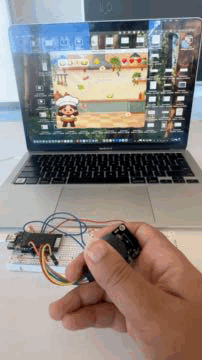
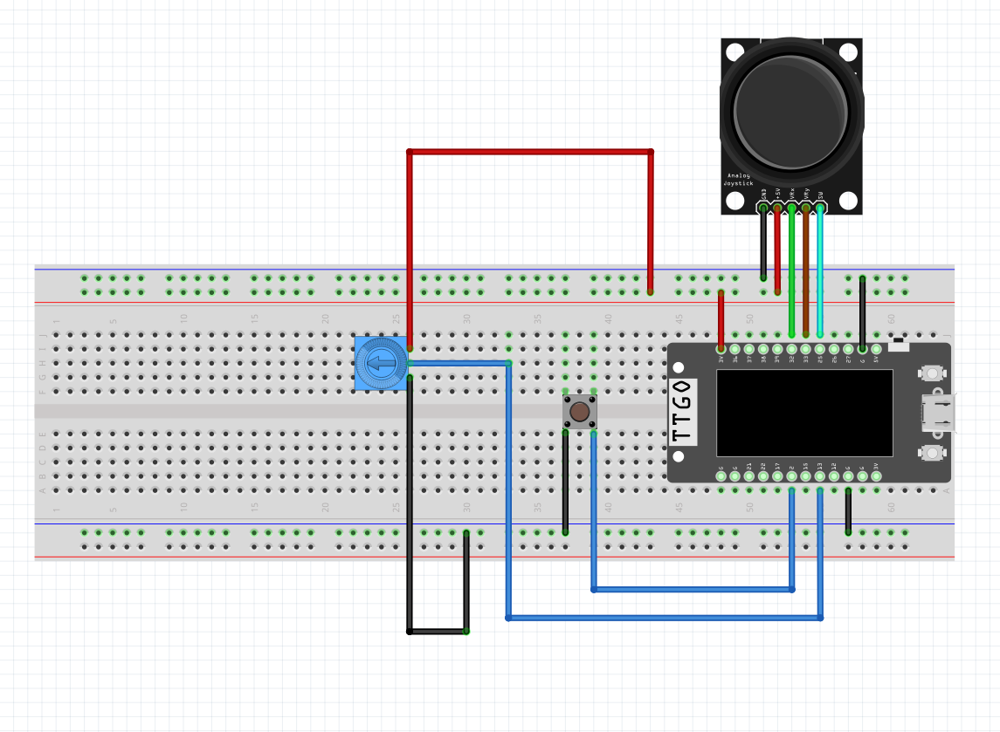

# SandwichRush 🥪

## About

SandwichRush is a cooking game inspired by the games I enjoyed playing as a child, especially Cooking Mama. I wanted to create something colorful, nostalgic, and fun while making use of three physical controls: a joystick, button, and potentiometer.

## Demo

  

## Materials Needed

- ESP32
- Breadboard
- Joystick
- Push button
- Potentiometer
- Jumper wires

## How to Make It

1. Connect the joystick, button, and potentiometer to the ESP32 using the breadboard and jumper wires. Refer to the circuit diagram below.
2. Download the code from this repository and open it in the appropriate development environment.
3. Make sure to change the pin numbers and port settings in the code to match your ESP32 board and connections.
4. Upload the controller code to the ESP32 and run the game code.

## Circuit Diagram

  

## How to Play

- **Joystick:** Move the chef left and right to catch falling ingredients.
- **Button:** Press once when you have finished preparing the sandwich. Double press to restart the game.
- **Potentiometer:** Adjust the speed of the falling ingredients.

## More Information

Visit my [blog](https://maria-meets-hardware.mta2152.chatgpt.site/projects/project-2) to learn more about the design process of SandwichRush.
